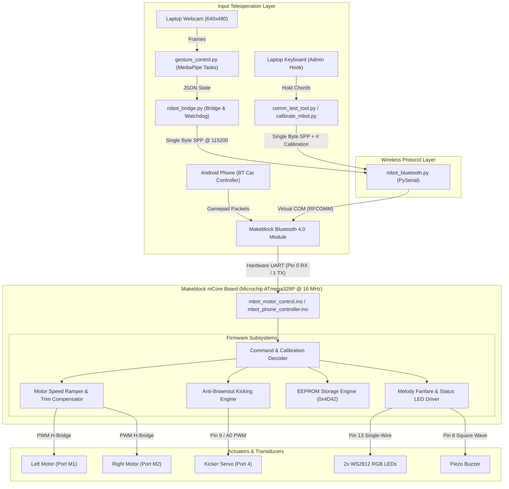
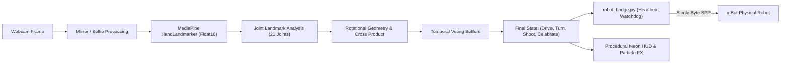

# 🤖 AGENT.md — Autonomous Agent Developer Guide & Repository Codex

> **Target Repository**: `techno-mbot` (Makeblock mBot Robot Football Showcase — Techno Exhibition)  
> **Repository Type**: Embedded Systems (Arduino AVR C++) + Computer Vision (Python / MediaPipe) + Wireless Teleoperation (Bluetooth SPP)  
> **Primary Purpose**: Complete technical reference and operational playbook for autonomous AI coding agents and human developers maintaining, testing, and extending this codebase.

---

## 📑 Table of Contents

1. [Executive Summary & Project Scope](#1-executive-summary--project-scope)
2. [High-Level Architecture & Data Flow](#2-high-level-architecture--data-flow)
3. [Repository File Map & Module Roles](#3-repository-file-map--module-roles)
4. [Hardware Specifications & Electrical Pinout](#4-hardware-specifications--electrical-pinout)
5. [Embedded Firmware Architecture](#5-embedded-firmware-architecture)
   - [Core Robot Firmware (`mbot_motor_control.ino`)](#core-robot-firmware-mbot_motor_controlino)
   - [Phone Controller Firmware (`mbot_phone_controller.ino`)](#phone-controller-firmware-mbot_phone_controllerino)
   - [Mechanical Kicker Calibration Sketch (`kicker_test.ino`)](#mechanical-kicker-calibration-sketch-kicker_testino)
   - [Serial & LED Bench Tester (`comm_usb_led_test.ino`)](#serial--led-bench-tester-comm_usb_led_testino)
6. [Communication Protocols & Byte Specifications](#6-communication-protocols--byte-specifications)
   - [UART Physical & Serial Layer](#uart-physical--serial-layer)
   - [Motion & Action Byte Matrix](#motion--action-byte-matrix)
   - [Live Calibration Protocol (`#` Command Set)](#live-calibration-protocol--command-set)
   - [EEPROM Memory Layout & Serialization](#eeprom-memory-layout--serialization)
7. [Computer Vision & AI Gesture Subsystem](#7-computer-vision--ai-gesture-subsystem)
   - [Tracking Pipeline & Model Architecture](#tracking-pipeline--model-architecture)
   - [Rotational Invariant Geometry & Palm Math](#rotational-invariant-geometry--palm-math)
   - [Multi-Frame Voting & Debouncing State Machines](#multi-frame-voting--debouncing-state-machines)
   - [Fail-Safe Bridge & Heartbeat Watchdog](#fail-safe-bridge--heartbeat-watchdog)
   - [Neon HUD Graphics & FX Engine](#neon-hud-graphics--fx-engine)
8. [Desktop Teleoperation & Diagnostics](#8-desktop-teleoperation--diagnostics)
   - [Windows Registry Bluetooth Port Resolver](#windows-registry-bluetooth-port-resolver)
   - [Low-Level Keyboard Hook Teleoperation](#low-level-keyboard-hook-teleoperation)
9. [Mission-Critical Gotchas & Hardware Constraints](#9-mission-critical-gotchas--hardware-constraints)
10. [Setup, Build, and Execution Recipes](#10-setup-build-and-execution-recipes)
11. [Rules for AI Agents Modifying This Codebase](#11-rules-for-ai-agents-modifying-this-codebase)

---

## 1. Executive Summary & Project Scope

The `techno-mbot` project is an agile robotics soccer platform developed for the **Techno Exhibition**. It transforms a standard educational **Makeblock mCore (ATmega328P)** mobile robot into an exhibition-ready soccer striker and dribbler.

The repository integrates four engineering layers:
1. **Mechanical & Hardware**: Dual geared DC drive motors, a high-torque 90° swinging servo kicker with custom 3D-printed striker arms, dual WS2812 RGB underglow/status LEDs, and a piezo audio buzzer.
2. **Firmware (Arduino AVR)**: Non-blocking embedded C++ firmware with speed ramping, motor balance trim, dynamic arc mathematics, anti-brownout power management, musical victory fanfare, and non-volatile EEPROM calibration.
3. **Wireless Communication**: Bluetooth 4.0 Serial Port Profile (SPP) @ 115200 baud, featuring Windows Registry Bluetooth discovery and an administrative teleoperation suite.
4. **Edge AI & Computer Vision**: Two-handed real-time teleoperation running on a standard laptop webcam via Google MediaPipe HandLandmarker (Float16) with an interactive sci-fi neon HUD.

---

## 2. High-Level Architecture & Data Flow



---

## 3. Repository File Map & Module Roles

```text
techno-mbot/
├── .gitignore                          # Standard git ignore definitions
├── README.md                           # Public showcase documentation & setup guide
├── requirements.txt                    # Top-level Python dependency specification
├── AGENT.md                            # THIS FILE — Autonomous Agent Engineering Codex
│
├── communication/                      # Subsystem: Host-to-Robot Wireless Transport
│   ├── README.md                       # Communication protocol & API documentation
│   ├── mbot_bluetooth.py               # Core MBotBluetooth driver & Windows Registry scanner
│   ├── comm_test_tool.py               # Desktop keyboard teleoperation & live EEPROM tuner
│   └── comm_usb_led_test/              # Bench validation firmware
│       └── comm_usb_led_test.ino       # Non-motor firmware for bench LED & serial testing
│
├── gestures/                           # Subsystem: Edge AI Computer Vision Teleoperation
│   ├── README.md                       # Gesture control documentation & operation guide
│   ├── PLAN.md                         # Initial architectural scratchpad
│   ├── INTEGRATION_PLAN.md             # Integration design history & decisions
│   ├── requirements.txt                # CV-specific Python dependencies
│   ├── hand_landmarker.task            # Google MediaPipe HandLandmarker Float16 model (~7.8 MB)
│   ├── robot_bridge.py                 # Teleoperation bridge, command translation & 0.5s heartbeat
│   └── gesture_control.py              # Full CV teleoperation pipeline with vector HUD & VFX
│
├── mbot_motor_control/                 # Subsystem: Primary Embedded Firmware
│   └── mbot_motor_control.ino          # Master firmware with ramping, trim, kicks, EEPROM & fanfare
│
├── mbot_phone_controller/              # Subsystem: Dedicated Smartphone Gamepad & Tuning
│   ├── README.md                       # Phone app button mapping & calibration guide
│   ├── mbot_phone_controller.ino       # Continuous-drive firmware mapped to standard RC apps
│   └── calibrate_mbot.py               # Standalone laptop calibration suite for phone firmware
│
├── kicker_test/                        # Subsystem: Mechanical Alignment & Calibration
│   └── kicker_test.ino                 # Servo alignment sketch locking safe home at 180°
│
└── Designs/                            # Subsystem: 3D CAD & Mechanical Assets
    ├── LeftArm.stl                     # 3D printable left kicker striker arm
    └── RightArm.stl                    # 3D printable right kicker striker arm
```

---

## 4. Hardware Specifications & Electrical Pinout

The robot is built upon the **Makeblock mCore v1.0** controller board, housing an **Atmel/Microchip ATmega328P** 8-bit AVR microcontroller clocked at 16 MHz with 32 KB Flash, 2 KB SRAM, and 1 KB EEPROM.

### Pinout Mapping

| Physical Component | mCore Port / Pin | ATmega328P Physical Pin | Subsystem Function |
|---|---|---|---|
| **Left Drive Motor** | **Port M1** | Pin D6 (PWM), Pin D7 (DIR) | TB6612FNG Dual H-Bridge Channel A |
| **Right Drive Motor** | **Port M2** | Pin D5 (PWM), Pin D4 (DIR) | TB6612FNG Dual H-Bridge Channel B |
| **Kicker Strike Servo** | **Port 4 (Header A0)** | **Digital Pin 9** (Timer1 OC1A) | Hardware PWM 50 Hz Servo Pulse |
| **Bluetooth Module** | **Onboard Header** | **Pin 0 (RX), Pin 1 (TX)** | Hardware USART0 @ 115200 Baud |
| **USB Serial Interface**| **Type-B Port** | **Pin 0 (RX), Pin 1 (TX)** | CH340G USB-to-UART Bridge |
| **Onboard RGB LEDs** | **Onboard** | **Digital Pin 13** | 2x Cascaded WS2812 (Left=1, Right=2) |
| **Piezo Buzzer** | **Onboard** | **Digital Pin 8** | Tone generator for musical feedback |
| **Main Power Jack** | **DC 2.1mm** | VIN / Raw Battery | 3.7V LiPo or 4x AA Battery Holder (4.8V - 6V) |

> [!CAUTION]
> **CRITICAL HARDWARE CONFLICT (UART PIN SHARING)**:
> The ATmega328P has only **one** hardware UART interface (`USART0` on Pins 0 and 1). This bus is physically wired in parallel to both the **CH340G USB-to-Serial converter** and the **Makeblock Bluetooth 4.0 daughterboard**.
> - **When flashing firmware via Arduino IDE**: You **MUST physically unplug** the Bluetooth module from the mCore board. Failing to do so causes bus contention; `avrdude` will fail with `stk500_getsync(): not in sync: resp=0x00`.
> - **When operating over Bluetooth**: The USB cable **MUST be disconnected** from the computer.

---

## 5. Embedded Firmware Architecture

### Core Robot Firmware (`mbot_motor_control.ino`)

The primary exhibition sketch provides an event-driven, non-blocking control loop:

1. **Acceleration Ramping (`setMotorSpeeds()`)**:
   - Abrupt PWM shifts cause high inrush current, leading to wheel slip, mechanical gear wear, and battery voltage sag.
   - Speed changes ramp smoothly in discrete steps:
     $$\Delta \text{Speed} = 15 \quad (\text{every } 20\text{ ms})$$
   - Target velocities are constrained to `[-currentSpeedCap, +currentSpeedCap]`.

2. **Steering Trim Compensation (`motorTrim`)**:
   - Geared hobby DC motors exhibit slight RPM differences due to internal friction and back-EMF variances.
   - `motorTrim` (range: `-50` to `+50`) balances driving straight:
     - Positive `motorTrim`: Slows the left wheel, boosts the right wheel (fixes pulling to the left).
     - Negative `motorTrim`: Slows the right wheel, boosts the left wheel (fixes pulling to the right).

3. **Smart Kicking Engine**:
   - **Stationary Kick (`'k'`)**:
     - Immediately brings wheel targets to `0`.
     - Flashes status LEDs yellow (`setLeds(150, 150, 0)`).
     - Drives kicker servo from rest ($180^\circ$) to strike ($90^\circ$), delays $150\text{ ms}$, then snaps back to rest ($180^\circ$) in $160\text{ ms}$.
     - Chirps buzzer at 1800 Hz.
   - **Running Kick (`'j'`) [Anti-Brownout Optimized]**:
     - Both wheels charge forward at `forwardSpeed` directly into the ball while the servo strikes.
     - **Crucial Electrical Rule**: Onboard WS2812 LEDs are explicitly **shut off** (`setLeds(0, 0, 0)`) during the strike. Simultaneous DC motor stall current and servo transient load draw upwards of 2.5 A; cutting LED consumption protects the ATmega328P 5V rail from dropping below the brownout detection threshold (2.7V/4.3V).
     - Audio chirp fires *after* the strike returns to rest.

4. **Victory Fanfare (`celebrate()`)**:
   - Six-step musical sequence playing notes C5 ($523\text{ Hz}$), E5 ($659\text{ Hz}$), G5 ($784\text{ Hz}$), and C6 ($1047\text{ Hz}$) on the buzzer.
   - Synchronized with alternating directional pivot turns ($\pm 100$ speed) and RGB cycling (Magenta, Cyan, Yellow, Green, Blue, Gold).

5. **Servo Driver Constraint**:
   - Uses `#include <utility/Servo.h>` (the driver bundled within Makeblock's library tree) rather than the standalone `<Servo.h>`. This prevents linker symbol duplication (`__vector_11` duplicate definitions).

---

### Phone Controller Firmware (`mbot_phone_controller.ino`)

A specialized variation tailored for standard off-the-shelf smartphone gamepad apps (e.g., *Bluetooth RC Controller* by Andi.Co, *Connectino*, *Bluetronics*).

- **Continuous Drive Logic**: Unlike generic sketches that auto-stop if packets cease, this sketch continuously runs the last motion state until an explicit release code (`'S'`, `'D'`, `' '`) is received.
- **Smart Adaptive Kick**: Virtual buttons `'Y'`, `'V'`, or `'X'` automatically execute a **Running Kick** if `isDrivingForward` is `true`, or a **Stationary Kick** if stationary.
- **Speed Slider Mapping**: Accepts `'0'` through `'9'` ASCII bytes to scale `currentSpeedCap` dynamically from $0\%$ to $100\%$.
- **Unified EEPROM Engine**: Shares the identical `#` calibration parser with `mbot_motor_control.ino`, allowing cross-calibration from laptop scripts.

---

### Mechanical Kicker Calibration Sketch (`kicker_test.ino`)

A dedicated utility sketch used during physical assembly:
- Strict mechanical boundaries: $[90^\circ, 180^\circ]$.
- On boot, energizes the servo and holds it locked at $180^\circ$ (Safe Rest).
- Builders mount the 3D-printed striker arm in its fully tucked-away position and screw in the horn without risk of stripping gears or over-rotating into the robot chassis.
- Serial commands: `'k'` (test strike), `'o'` (hold open at $90^\circ$ to measure ball contact height), `'p'` (retract to $180^\circ$).

---

### Serial & LED Bench Tester (`comm_usb_led_test.ino`)

A lightweight validation sketch designed for bench testing communication links without motor actuation:
- Completely disconnects DC motors.
- Decodes incoming serial bytes and visualizes them on the WS2812 LEDs (e.g., `'w'` = Green, `'s'` = Red, `'a'`/`'d'` = Blue, `'k'` = Yellow beep).
- Safe to run over a direct USB cable while diagnosing PC serial port drivers.

---

## 6. Communication Protocols & Byte Specifications

### UART Physical & Serial Layer
- **Baud Rate**: `115200`
- **Data Bits**: 8
- **Parity**: None
- **Stop Bits**: 1
- **Flow Control**: None (Raw Software Streaming)

---

### Motion & Action Byte Matrix

| Primary ASCII | Phone RC Code | Action Classification | Motor Left Target | Motor Right Target | Visual LED State | Audio Feedback |
|:---:|:---:|---|:---:|:---:|---|---|
| `'w'` | `'F'` | Forward Drive | `+forwardSpeed` | `+forwardSpeed` | Dual Green (`0, 150, 0`) | None |
| `'s'` | `'B'` | Backward Drive | `-backwardSpeed` | `-backwardSpeed` | Dual Red (`150, 0, 0`) | None |
| `'a'` | `'L'` | In-Place Pivot Left | `-turnSpeed` | `+turnSpeed` | Left Blue, Right Off | None |
| `'d'` | `'R'` | In-Place Pivot Right | `+turnSpeed` | `-turnSpeed` | Right Blue, Left Off | None |
| `'q'` | `'G'` | Forward-Left Arc | `+innerSpeed` | `+outerSpeed` | Cyan Left (`0, 150, 150`) | None |
| `'e'` | `'H'` / `'I'`| Forward-Right Arc | `+outerSpeed` | `+innerSpeed` | Cyan Right | None |
| `'z'` | `'I'` / `'H'`| Backward-Left Arc | `-innerSpeed` | `-outerSpeed` | Dim Magenta Left | None |
| `'c'` | `'J'` | Backward-Right Arc | `-outerSpeed` | `-innerSpeed` | Dim Magenta Right | None |
| `' '` | `'S'` / `'D'`| Full Stop | `0` | `0` | All LEDs OFF | None |
| `'k'` | `'X'` / `'V'`| Stationary Kick | `0` (Hold) | `0` (Hold) | Yellow Pulse | Chirp (1800 Hz) |
| `'j'` | — | **Running Kick** | `+forwardSpeed` | `+forwardSpeed` | **ALL LEDs OFF** | Chirp after strike |
| `'v'` | `'Z'` / `'C'`| Victory Celebration | $\pm \text{celebrateSpeed}$ | $\mp \text{celebrateSpeed}$ | Dynamic Rainbow | 6-step Fanfare |
| `'x'` | — | 180° Spin Around | `-150` | `+150` | Dual Amber (`150, 150, 0`) | None |
| `'o'` | — | Kicker Deploy (Debug) | Unchanged | Unchanged | Yellow (`150, 150, 0`) | None |
| `'p'` | — | Kicker Retract (Debug) | Unchanged | Unchanged | Green (`0, 150, 0`) | None |
| `'+'` | — | Increase Speed Cap | Dynamic | Dynamic | Unchanged | High Beep (1500 Hz) |
| `'-'` | — | Decrease Speed Cap | Dynamic | Dynamic | Unchanged | Low Beep (800 Hz) |

---

### Live Calibration Protocol (`#` Command Set)

The firmware incorporates a packet parser triggered by the `#` prefix, terminated by `\r` or `\n`. This allows real-time tuning of motor kinetics and kinematics without recompiling or flashing firmware.

| Command Format | Target Variable | Delta / Action | Value Range |
|---|---|---|---|
| `#W+` / `#W-` | `forwardSpeed` | $\pm 10$ | 30 to 255 |
| `#S+` / `#S-` | `backwardSpeed` | $\pm 10$ | 30 to 255 |
| `#A+` / `#A-` | `turnSpeed` | $\pm 5$ | 30 to 255 |
| `#Q+` / `#Q-` | `curveInnerRatio` | $\pm 5\%$ | 10% to 95% |
| `#O+` / `#O-` | `curveSpeed` | $\pm 10$ | 30 to 255 |
| `#T+` / `#T-` | `motorTrim` | $\pm 2$ | -50 to +50 |
| `#X+` / `#X-` | `rotate180Ms` | $\pm 25\text{ ms}$ | 100 to 3000 ms |
| `#K+` / `#K-` | `kickAngle` | $\pm 5^\circ$ | 90° to 180° |
| `#C+` / `#C-` | `currentSpeedCap` | $\pm 15$ | 30 to 255 |
| `#<KEY>:<VAL>`| Direct Assignment | Sets `<KEY>` directly to `<VAL>` (e.g. `#W:180`, `#T:4`) | Validated by key |
| `#?` / `#STATUS`| Inspection | Dumps complete configuration table back via serial | Read-only |
| `#SAVE` | Non-volatile commit | Serializes `RobotConfig` struct to internal EEPROM | Writes 20 bytes |
| `#RESET` | Factory Restore | Restores factory defaults and overwrites EEPROM | Hardcoded defaults |

---

### EEPROM Memory Layout & Serialization

Settings are persisted in the ATmega328P internal 1024-byte EEPROM at base address `0x0000` via the C struct `RobotConfig`:

```cpp
const uint16_t EEPROM_MAGIC = 0x4D42; // "MB" (MakeBlock identifier)
const int EEPROM_START_ADDR = 0;

struct RobotConfig {
  uint16_t magic;           // Offset 0: 0x4D42 validation word (2 bytes)
  int forwardSpeed;         // Offset 2: Forward drive PWM (2 bytes)
  int backwardSpeed;        // Offset 4: Backward drive PWM (2 bytes)
  int turnSpeed;            // Offset 6: Pivot spin PWM (2 bytes)
  int curveOuterSpeed;      // Offset 8: Arc outer wheel PWM (2 bytes)
  int curveInnerRatio;      // Offset 10: Inner wheel percentage (2 bytes)
  int motorTrim;            // Offset 12: Motor balance offset (2 bytes)
  unsigned long rotate180Ms;// Offset 14: Turnaround duration in ms (4 bytes)
  int kickAngle;            // Offset 18: Servo front strike angle (2 bytes)
  int speedCap;             // Offset 20: Global ceiling PWM (2 bytes)
}; // Total size: 22 bytes
```

On boot, `loadConfigFromEEPROM()` inspects `cfg.magic`. If it matches `0x4D42`, parameters are loaded and clamped. If corrupt or uninitialized, factory defaults are enforced.

---

## 7. Computer Vision & AI Gesture Subsystem

Located in `gestures/`, this subsystem allows contact-free piloting of the robot using a single webcam and Google MediaPipe.



### Tracking Pipeline & Model Architecture
- **Model Task**: `gestures/hand_landmarker.task` (Google MediaPipe HandLandmarker float16 task bundle, ~7.8 MB).
- **Execution Mode**: `RunningMode.VIDEO` (stateful temporal tracking between consecutive frames to prevent fist dropouts).
- **Auto-Download**: If `hand_landmarker.task` is absent, `gesture_control.py` automatically pulls it from Google Cloud Storage on launch.
- **Handedness Separation**:
  - When two hands are visible: The hand on the screen's left controls **Drive**, while the hand on the screen's right controls **Steer & Kick**. (MediaPipe's internal handedness classification is bypassed in two-hand mode due to ambiguity on closed fists).
  - When a single hand is visible: A spatial hysteresis buffer (`HAND_STICKY_DIST = 0.15`, `HAND_MEMORY_SEC = 0.5s`) retains the side assignment.

---

### Rotational Invariant Geometry & Palm Math

1. **Palm vs. Back-of-Hand Detection (Drive Hand)**:
   - Evaluated using the 2D cross product of the vectors from the wrist to the index knuckle and wrist to the pinky knuckle:
     $$\vec{u} = \text{Landmark}[5] - \text{Landmark}[0] \quad (\text{Wrist} \to \text{Index MCP})$$
     $$\vec{v} = \text{Landmark}[17] - \text{Landmark}[0] \quad (\text{Wrist} \to \text{Pinky MCP})$$
     $$\text{Cross Product} = (\vec{u}_x \cdot \vec{v}_y) - (\vec{u}_y \cdot \vec{v}_x)$$
   - If $\text{Sign}(\text{Cross}) == \text{PALM\_FACING\_CROSS\_SIGN}$ (default `-1`): **Palm faces camera $\to$ FORWARD**.
   - If opposite sign: **Back of hand faces camera $\to$ BACKWARD**.
   - If $|\sin \theta| < 0.25$ (`ORIENTATION_MIN_SIN`): Hand is edge-on $\to$ Neutral/Stop.
   - This vector geometry guarantees accurate detection regardless of distance, pitch, or roll.

2. **Rotational-Invariant Finger Curl**:
   - Compares tip-to-wrist distance versus PIP-joint-to-wrist distance:
     $$\text{dist}(\text{Wrist}, \text{Tip}) > \text{dist}(\text{Wrist}, \text{PIP}) \times 1.15$$
   - Eliminates false triggers caused by simply tilting the hand toward the camera.

---

### Multi-Frame Voting & Debouncing State Machines

To ensure instantaneous responsiveness without false triggers from dropped camera frames, one-shot actions utilize rolling vote windows:
- **Shoot (Right Fist)**: Window size $5$, requires $3$ positive detections to trigger, and $1$ frame of release before re-arming (`SHOOT_COOLDOWN_SEC = 0.6s`).
- **Celebrate (Dual Rock-On Sign)**: Window size $9$, requires $6$ positive detections, and $2$ frames of release (`CELEBRATE_COOLDOWN_SEC = 2.5s`).
- **Continuous Drive/Turn**: Require $5$ and $4$ consecutive frames respectively to lock state transitions.

---

### Fail-Safe Bridge & Heartbeat Watchdog

`gestures/robot_bridge.py` operates as the abstraction layer between CV state and the robot:
- **Combo Resolution**:
  - `forward` + `turn_left` $\to$ `'q'` (Forward-Left Arc)
  - `forward` + `turn_right` $\to$ `'e'` (Forward-Right Arc)
  - `backward` + `turn_left` $\to$ `'z'` (Backward-Left Arc)
  - `backward` + `turn_right` $\to$ `'c'` (Backward-Right Arc)
  - `stop` + `turn_left` $\to$ `'a'` (Pivot Left)
  - `stop` + `turn_right` $\to$ `'d'` (Pivot Right)
  - `forward` + `shoot` $\to$ `'j'` (Running Kick)
  - `stop` + `shoot` $\to$ `'k'` (Stationary Kick)
  - `celebrate` $\to$ `'v'` (Fanfare)
- **Heartbeat Transmission**: Re-transmits the active motion byte every `0.5s` (`HEARTBEAT_SEC`).
- **Auto-Stop Failsafe**: If hands vanish from frame, the bridge immediately commands `' '` (Stop). If an unhandled serial exception occurs, it attempts one final stop transmission and safely closes the port.

---

### Neon HUD Graphics & FX Engine

A custom procedural vector graphics renderer drawn directly onto OpenCV BGR frames:
- **Color Palette**: Cyberpunk Neon theme (High-saturation Cyan `(255, 230, 40)`, Neon Green `(80, 255, 140)`, Bright Red `(70, 60, 255)`, Vivid Amber `(0, 190, 255)`, Magenta `(255, 40, 230)`). Inactive indicators use dimmed saturation rather than invisible greys.
- **Particle System**: 120-particle physics engine calculating gravity, drag, velocity, and color decay for celebratory confetti and firework explosions.
- **Dynamic Gauges**: Steering deadzone gauge ($\pm 15^\circ$), reload progress bar, and real-time command ribbon.

---

## 8. Desktop Teleoperation & Diagnostics

### Windows Registry Bluetooth Port Resolver

Standard Python libraries (`pyserial.tools.list_ports`) often fail on Windows by listing generic "Standard Serial over Bluetooth link" names and cannot distinguish between incoming (slave) and outgoing (master) RFCOMM channels.

`communication/mbot_bluetooth.py` contains a Windows Registry parser:
- Reads: `HKLM\SYSTEM\CurrentControlSet\Services\BTHPORT\Parameters\Devices`
- Matches MAC address strings against paired device friendly names.
- Flags and filters `000000000000` dummy incoming listen ports.
- Automatically discovers devices containing `"makeblock"`, `"mbot"`, or `"robot"`.

---

### Low-Level Keyboard Hook Teleoperation

`communication/comm_test_tool.py` and `mbot_phone_controller/calibrate_mbot.py` utilize the Python `keyboard` library:
- Intercepts OS-level scan codes for true **Hold-to-Move** driving.
- Multi-key chord detection: Pressing `W` and `A` simultaneously transmits `'q'` (Forward-Left Arc); pressing `W` and `K` transmits `'j'` (Running Kick).
- Releasing all keys instantly sends `' '` (Stop).
- Live calibration using `Ctrl` / `Alt` modifier keys with immediate terminal status feedback.

---

## 9. Mission-Critical Gotchas & Hardware Constraints

When modifying, building, or troubleshooting this codebase, adhere to these five core constraints:

### 1. The Single Hardware UART Bottleneck
- **Problem**: The ATmega328P only has one UART serial channel (Pins 0 & 1), shared by the USB bridge (CH340G) and Bluetooth header.
- **Consequence**: Flashing firmware via USB with Bluetooth plugged in results in `avrdude: stk500_getsync()` synchronization failure.
- **Remedy**: Always physically detach the Bluetooth module before plugging in USB to flash code! Disconnect USB before attempting Bluetooth pairing.

### 2. Brownout Reset on Simultaneous High-Current Draw
- **Problem**: Stalling DC drive motors while rapidly swinging the kicker servo draws up to 3 A. On weakened AA batteries, the 5V logic rail will dip below the ATmega328P brownout threshold, resetting the robot.
- **Remedy**: Firmware explicitly turns off all WS2812 LEDs during running kicks (`'j'`) and delays buzzer audio until the mechanical strike has completed. Never re-enable LEDs during kicks.

### 3. Kicker Mechanical Travel Range Limits
- **Problem**: The 3D-printed kicker arm is physically blocked by the mBot metal chassis if rotated beyond the $[90^\circ, 180^\circ]$ interval.
- **Consequence**: Driving the servo to $0^\circ$ will stall the servo motor, overheat internal gears, and shear the plastic horn splines.
- **Remedy**: In code, always constrain servo writes: `constrain(angle, 90, 180)`. Always mount the arm using `kicker_test.ino` at $180^\circ$.

### 4. Admin Privileges for Low-Level Keyboard Hooks
- **Problem**: The Python `keyboard` library interacts directly with Windows OS raw input hooks (`SetWindowsHookEx`).
- **Consequence**: Running `comm_test_tool.py` in an unprivileged command prompt raises `PermissionError` or fails to detect background key releases.
- **Remedy**: Always launch PowerShell or Command Prompt with **Run as Administrator** on Windows.

### 5. Disabled Microcontroller Failsafe Timeout
- **Problem**: The communication failsafe timer in `mbot_motor_control.ino` is commented out (`COMM_TIMEOUT_MS` disabled) to permit hold-to-drive operation in phone apps.
- **Consequence**: If a host PC crashes or loses power without sending a stop byte, the robot will continue driving at its last velocity.
- **Remedy**: Software clients (`robot_bridge.py`, `comm_test_tool.py`) are strictly responsible for sending 0.5s heartbeats and issuing explicit stop bytes on shutdown or exception.

---

## 10. Setup, Build, and Execution Recipes

### Python Environment Setup

```powershell
# 1. Open PowerShell in repository root
cd c:\Users\sayur\Documents\GitHub\techno-mbot

# 2. Create and activate virtual environment (Python 3.9 - 3.11 recommended)
python -m venv venv
.\venv\Scripts\activate

# 3. Install core dependencies
pip install pyserial keyboard opencv-python mediapipe numpy
```

---

### Arduino IDE Firmware Deployment

1. **Hardware Preparation**: Power OFF mBot. **Unplug Bluetooth module**. Connect USB cable between mBot and PC. Power ON mBot.
2. **IDE Configuration**:
   - Board: `Arduino Uno`
   - Processor: `ATmega328P`
   - Port: Select active USB COM port (e.g., `COM3`, `COM4`)
   - Library: Verify `MakeBlock` library is installed.
3. **Flashing**: Open `mbot_motor_control/mbot_motor_control.ino` (or `mbot_phone_controller/mbot_phone_controller.ino`). Click **Upload**.
4. **Post-Flash**: Disconnect USB. Re-seat Bluetooth daughterboard securely. Power cycle the mBot.

---

### Execution Workflows

#### Mode 1: AI Gesture Teleoperation
```powershell
python gestures/gesture_control.py
```
*Auto-detects paired mBot over Bluetooth, opens webcam, and displays Neon HUD. Press `q` to quit.*

#### Mode 2: Keyboard Driving & Live EEPROM Calibration
```powershell
# Launch terminal AS ADMINISTRATOR
python communication/comm_test_tool.py
```
*Select COM port. Hold `W/A/S/D/Q/E/Z/C` to drive. Use `Ctrl` + `W/S/A/T/K/X` to tune parameters. Press `Ctrl + Enter` to commit to EEPROM.*

#### Mode 3: Mechanical Servo Alignment
```powershell
# Flash kicker_test/kicker_test.ino via USB
# Open Serial Monitor at 115200 baud
```
*Servo locks at $180^\circ$. Fasten the 3D printed arm in the retracted position. Send `'k'` to test 90° strike.*

#### Mode 4: Standalone Bench Testing (No Motors)
```powershell
# Flash communication/comm_usb_led_test/comm_usb_led_test.ino via USB
# Send 'w', 's', 'a', 'd', 'k', 'v' to test RGB LEDs and Buzzer responses.
```

---

## 11. Rules for AI Agents Modifying This Codebase

When tasked with generating code, refactoring, or extending this repository, any autonomous AI agent **MUST** enforce the following rules:

1. **Preserve Baud Rates**: Never alter the serial baud rate from `115200`. The physical Makeblock Bluetooth module firmware is factory locked at 115200. Changing baud in `.ino` sketches will brick wireless communication.
2. **Preserve Arduino Memory Footprint**: The ATmega328P has only **2048 bytes of RAM**.
   - Always wrap string literals in `F()` macros: `Serial.println(F("text"))`.
   - Never use dynamic allocation (`malloc`, `new`) or `String` class objects in the Arduino firmware; use static stack buffers and standard C-strings (`char[]`, `snprintf`, `strcmp`).
3. **Keep Non-Blocking Loops**: Never insert blocking `delay()` calls inside the Arduino `loop()` during active motion. Speed ramping and command processing depend on continuous, high-speed loop execution.
4. **Enforce Servo Range Boundaries**: Any code controlling the kicker servo must clamp output angles between $90^\circ$ and $180^\circ$. Never command angles below $90^\circ$.
5. **Synchronize Dual Implementations**: If a new motion or calibration command is introduced in `mbot_motor_control.ino`, the corresponding support **MUST** be mirrored in:
   - `mbot_phone_controller/mbot_phone_controller.ino`
   - `communication/mbot_bluetooth.py` (high-level API)
   - `communication/comm_test_tool.py` (keyboard map)
   - `gestures/robot_bridge.py` (CV state resolver)
6. **Maintain Anti-Brownout Precaution**: When implementing any high-torque mechanical action (kicking, fast reverse braking), always extinguish the onboard WS2812 LEDs to conserve current.
7. **Safe Fallbacks in Python**: Python modules importing `pyserial` or `keyboard` must handle missing drivers gracefully and provide informative troubleshooting instructions for non-admin permissions or missing COM ports.
